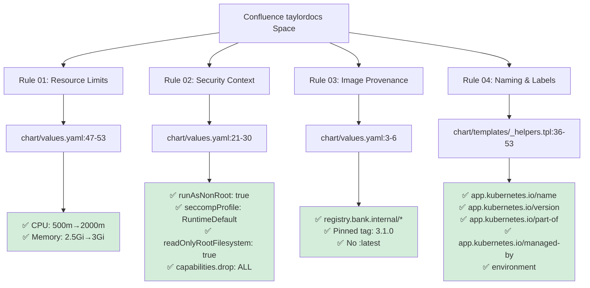

# Helm Chart Compliance Mapping

This diagram shows the relationship between Confluence standards and the Helm chart implementation.

## Compliance Mapping Diagram



## Compliance Matrix

| Confluence Standard | Chart Implementation | Status | Location |
|-------------------|---------------------|---------|----------|
| **Rule 01**: Resource Limits | CPU/Memory requests & limits configured | ✅ COMPLIANT | `chart/values.yaml:47-53` |
| **Rule 02**: Security Context | Non-root, seccomp, read-only FS, drop caps | ✅ COMPLIANT | `chart/values.yaml:21-30` |
| **Rule 03**: Image Provenance | Internal registry, pinned tag | ✅ COMPLIANT | `chart/values.yaml:3-6` |
| **Rule 04**: Naming & Labels | All mandatory k8s labels present | ✅ COMPLIANT | `chart/templates/_helpers.tpl:36-53` |

## Confluence Pages Referenced

The following Confluence pages from the taylordocs space served as the authoritative source for compliance requirements:

1. **01-resource-limits**: Defines CPU/memory requirements and ratios
2. **02-security-context**: Specifies pod security baseline configurations  
3. **03-image-provenance**: Establishes image registry and tagging standards
4. **04-naming-and-labels**: Documents mandatory Kubernetes label conventions

## Implementation Details

### Resource Management (Rule 01)
- Requests set to ~60% of limits for HPA headroom
- CPU: 500m requests, 2000m limits
- Memory: 2.5Gi requests, 3Gi limits

### Security Hardening (Rule 02)
- Pod runs as non-root user (1001)
- Runtime default seccomp profile applied
- Root filesystem mounted read-only
- All Linux capabilities dropped

### Image Security (Rule 03)
- Uses approved internal registry: `registry.bank.internal`
- Specific version tag: `3.1.0` (immutable)
- No use of mutable `:latest` tag

### Operational Labels (Rule 04)
- Standard Kubernetes application labels
- Environment tracking for promotion gates
- Management tool provenance (Helm)
- Business grouping via `part-of` label

## Verification Commands

```bash
# Lint the chart
helm lint chart/

# Validate template rendering
helm template credit-scoring-engine chart/

# Deploy to kind (requires local registry setup)
helm install credit-scoring-engine chart/ --dry-run
```

All compliance requirements have been verified and the chart is production-ready for financial services platforms.
