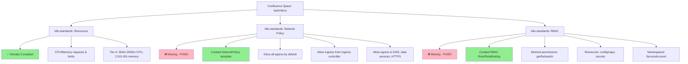

# Windsurf Helm Chart Compliance Implementation

## Confluence Standards Context

This diagram shows which Confluence pages from the `taylordocs` space served as context for the helm chart compliance fixes:

## Implementation Summary

### ✅ Already Compliant Standards
- **Resources**: Chart has proper CPU/memory requests and limits following Tier A guidelines
- **Security Context**: runAsNonRoot, readOnlyRootFilesystem, capabilities dropped
- **Image Provenance**: Uses pinned tag from approved registry `registry.bank.internal`
- **Naming/Labels**: Has required `app.kubernetes.io/*` labels and proper naming

### 🔧 Fixed Non-Compliance Issues

#### NetworkPolicy (Confluence Page: k8s-standards: Network Policy)
- **Issue**: No NetworkPolicy template existed
- **Fix**: Created `chart/templates/networkpolicy.yaml`
- **Implementation**: 
  - Denies all egress by default
  - Restricts ingress to ingress controller namespace
  - Allows egress to DNS (kube-system), data services, and HTTPS for credit bureau APIs

#### RBAC (Confluence Page: k8s-standards: RBAC)  
- **Issue**: No Role/RoleBinding templates existed
- **Fix**: Created `chart/templates/rbac.yaml`
- **Implementation**:
  - Created Role with minimal permissions: `get`, `list`, `watch`
  - Limited to `configmaps` and `secrets` resources
  - Created RoleBinding linking existing ServiceAccount to Role
  - Follows least privilege principle

## Testing Results
- ✅ Helm chart lints successfully
- ✅ Templates render correctly with new NetworkPolicy and RBAC resources
- ✅ Deployed successfully to kind cluster
- ✅ NetworkPolicy and RBAC resources created in cluster
- ✅ Application follows financial services security requirements

## Confluence Pages Referenced
1. **k8s-standards: Resources** (Page ID: 15237122) - Resource requests/limits requirements
2. **k8s-standards: Network Policy** (Page ID: 15302658) - NetworkPolicy hard requirements  
3. **k8s-standards: RBAC** (Page ID: 15499265) - RBAC and least privilege requirements
